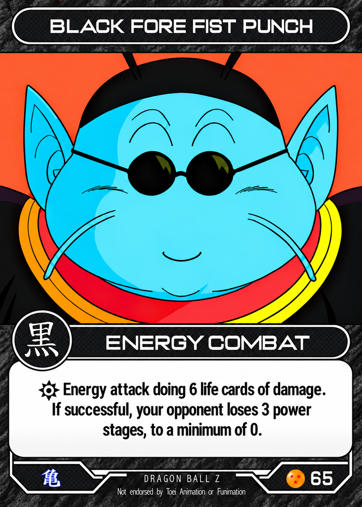

# Dragon Ball OCG card templates

Use this collection as the repository's index of approved production masters for future cards. A template is ready only when its status is **approved** in [catalog.json](catalog.json). Pending folders reserve a place for later work; they contain no approved artwork.

| Card type | Status | Version |
| --- | --- | --- |
| [Combat](combat/) — Physical and Energy | Approved October 15, 2026 | 1.0.0 |
| [Main Personalities](main-personalities/) | Pending | — |
| [Masteries](masteries/) | Pending | — |
| [Locations / Battlegrounds](locations-battlegrounds/) | Pending | — |
| [Sensei](sensei/) | Pending | — |
| [Dragon Balls](dragon-balls/) | Pending | — |
| [Events](events/) | Pending | — |
| [Setups](setups/) | Pending | — |
| [Drills](drills/) | Pending | — |

## Approved Combat Master

The Combat package is an exact copy of the approved Dragon Ball OCG Combat Master skill, including:

- [Reference PNG](combat/assets/reference.png) and matching preview, at 1060 × 1484 pixels.
- [Reusable vector frame](combat/assets/combat-master-frame.svg) and [border linework](combat/assets/combat-border-vectors.svg).
- [Layout coordinates](combat/assets/combat-layout.json) for the title, combat bar, badge, rules box, set emblem, rarity ball, and card number.
- [Production rules](combat/references/combat-production.md) for typography, textures, symbols, wording, rarity, and visual checks.
- The original skill instructions, manifest, and interface metadata, so the package remains reusable.

Preserve the dark charcoal-gray outer texture, thin continuous borders, dark diamond panel pattern, centered set emblem, and aligned rarity/number group. The Black style example establishes this layout; other styles still require their approved colors and symbols. Verify the card's title, category, rules, number, and rarity individually. The three-star ball belongs to this Uncommon example and is not a default for every card.

The SVG files contain genuine editable vector geometry. The reference illustration and lettering are raster; exact original font files are not included. Do not treat the reference PNG as an editable vector card or reprocess clean SVG borders through repeated AI edits.

## Using and updating masters

1. Check the category and approval status before producing a card. Read its layout and production rules, then inspect the retained reference.
2. Verify the card-specific wording against the latest supplied Expanded CRD and source card. Keep the project's category names: Event, Setup, and Drill.
3. Preserve each master when creating card-specific copies. Inspect clean lines, typography, artwork, and both footer alignments before approving an export.
4. After a revised master is approved, update its reference and preview, any affected vectors or layout rules, its version, and the catalog together. Keep the ChatGPT master skill synchronized with the same approved assets. Record the source skill commit and reference checksum when copying an update from that skill.
5. Add other finished templates to their reserved folders and mark them approved only after their designs are approved. Do not infer their final status from older reference images or render scripts.

Older files in `../card-frames/` remain available for existing rendering workflows and history. The approved Combat Master here is the visual reference for new combat-card production; older scripts may need an explicit adaptation before they can reproduce it. Adding these masters does not regenerate or replace existing card images.

## Site assets

These files are production sources under `tools/`. The current Wrangler configuration serves assets from `public/`, so this collection is not included in gameplay downloads. Optimized gameplay images and print/download exports are separate deliverables produced when requested.
